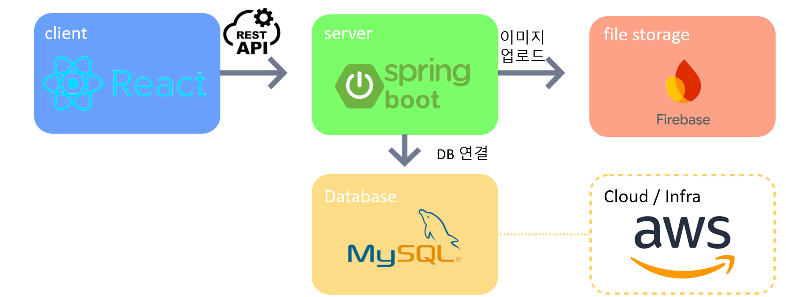
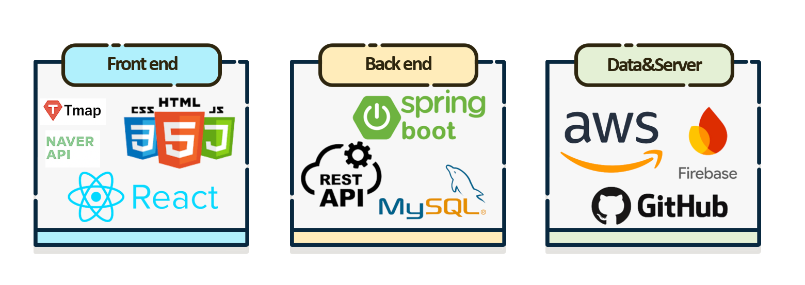
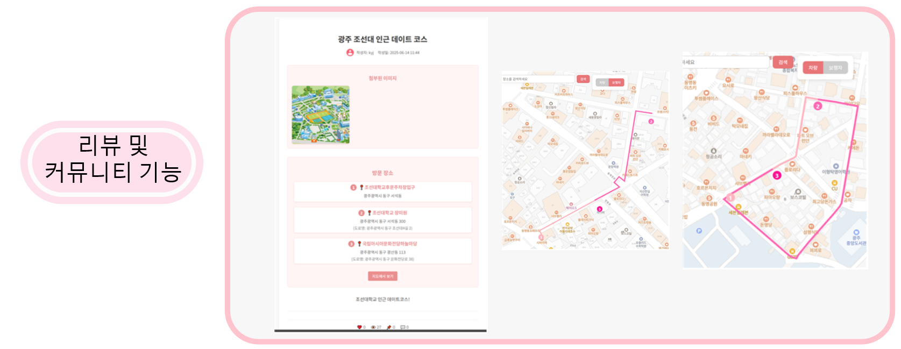
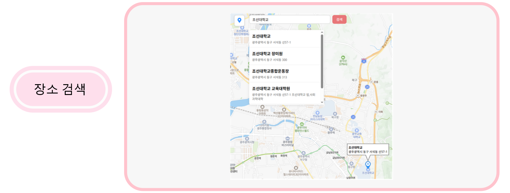

# 🌤️ WeatherPick

**장소 추천 및 리뷰 플랫폼**

## 📖 프로젝트 소개

사용자가 직접 위치를 등록하여 글을 작성하고 지도에서 위치의 순서대로 경로를 제공하여 장소에 대한 리뷰를 공유할 수 있는 서비스입니다.

### 아키텍처

### 기술 스택

## 🖼️ 서비스 화면

### 네비게이션

### 장소 검색

### 리뷰

---

[//]: # (서비스 설명)
## 🔗 Service

|        Service        | Description                                                                      |
|:---------------------:|:---------------------------------------------------------------------------------|
|      🔒 **Auth**      | JWT 기반 인증·인가 및 사용자 인증 처리                                             |
|     👤 **User**       | 사용자 회원가입, 로그인, 사용자 정보 조회 및 수정 등 **사용자 관리**                       |
|     🌤️ **TMAP**    | TMAP API 연동을 통한 경로 정보 제공                                          |
|     📝 **Review**     | 장소별 리뷰 게시글 작성, 수정, 삭제, 좋아요, 스크랩 및 댓글 관리                          |
|     📍 **Place**      | 네이버 장소 검색 API 연동을 통한 장소 정보 조회 및 관리                                   |
|     📁 **File**       | 이미지 파일 업로드 및 AWS S3를 통한 파일 관리                                        |

[//]: # (아키텍처 - 수정 중)

[//]: # (사용 기술 - 수정 중)
## 🛠️ Tech Stack

### 💻 Develop

  
  
  
  
  
  

### 🚀 Infra & CI/CD

  
  
  
  

